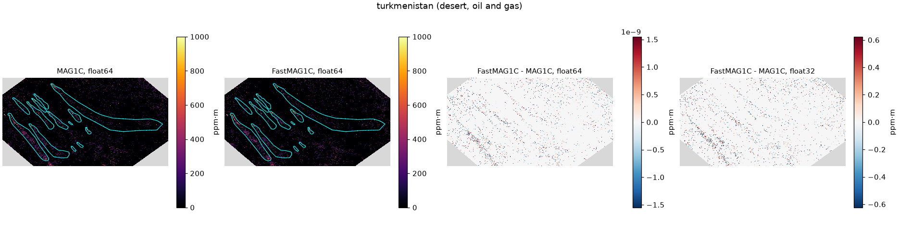
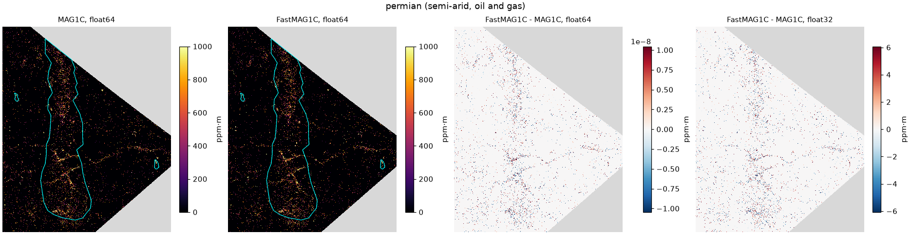
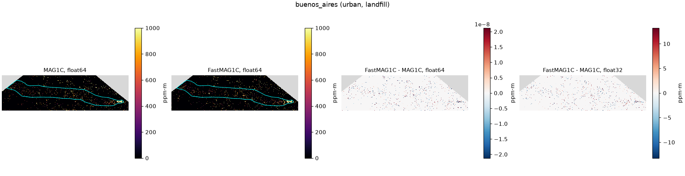
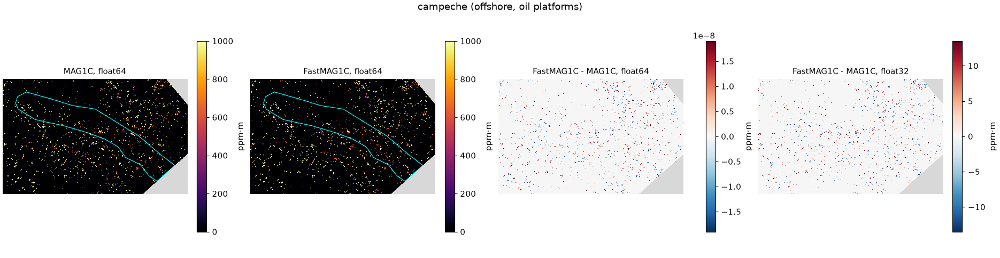
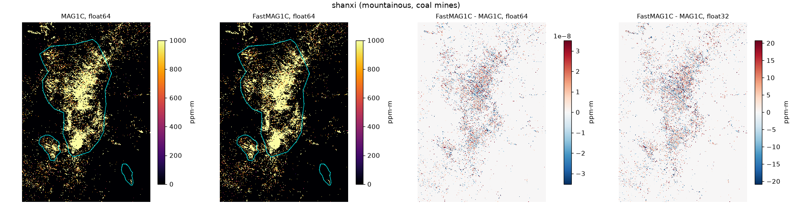
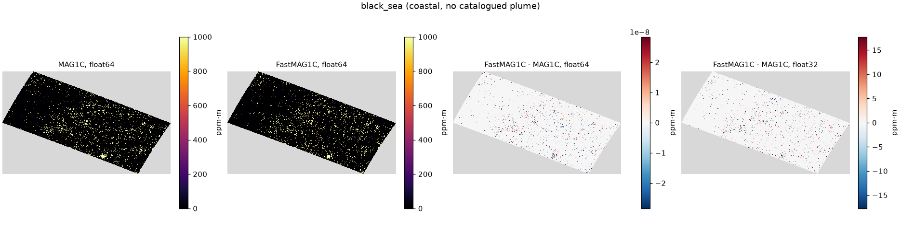

# MAG1C and FastMAG1C on EMIT plume scenes

We ran both filters on five EMIT L1B granules with plumes from the EMIT L2B
CH4 plume catalog, and on one granule over the Black Sea coast with no
catalogued plume. Every granule was retrieved with 50 bands (2122 to 2488 nm)
and with 128 bands (1550 to 2493 nm), in float64 and in float32, with 30
iterations.

A pixel counts as a plume pixel when its orthorectified position falls inside
one of the catalogued plume polygons. All differences are absolute and in
ppm·m.

## Granules

| Name | Surface | L1B granule | Plumes |
|---|---|---|---|
| turkmenistan | desert, oil and gas | EMIT_L1B_RAD_001_20230607T062333_2315804_033 | 13 |
| permian | semi-arid, oil and gas | EMIT_L1B_RAD_001_20240127T195904_2402713_008 | 3 |
| buenos_aires | urban, landfill | EMIT_L1B_RAD_001_20231124T142642_2332809_049 | 1 |
| campeche | offshore, oil platforms | EMIT_L1B_RAD_001_20240823T173814_2423611_036 | 1 |
| shanxi | mountainous, coal mines | EMIT_L1B_RAD_001_20240217T052731_2404804_010 | 3 |
| black_sea | coastal, no plume | EMIT_L1B_RAD_001_20240604T140353_2415609_030 | 0 |

The plume polygons are in [granules.json](granules.json).

## Float64

Largest |FastMAG1C - MAG1C| with both filters in float64.

| Granule | Plume pixels | 50 bands, all | 50 bands, plume | 128 bands, all | 128 bands, plume |
|---|---|---|---|---|---|
| turkmenistan | 176,925 | 4.6e-07 | 2.9e-07 | 1.6e-06 | 9.3e-07 |
| permian | 93,661 | 5.4e-06 | 1.7e-06 | 1.2e-05 | 5.2e-06 |
| buenos_aires | 105,594 | 1.5e-05 | 8.1e-06 | 9.8e-06 | 8.5e-06 |
| campeche | 57,883 | 6.7e-05 | 1.4e-06 | 2.5e-05 | 5.5e-06 |
| shanxi | 49,916 | 3.0e-04 | 1.1e-05 | 1.6e-05 | 5.2e-06 |
| black_sea | 0 | 2.1e-04 | n/a | 8.9e-05 | n/a |

The worst case over every granule and window is 3e-4 ppm·m, and 1.1e-5 ppm·m
inside the plumes. In float64 the two filters produce the same map. What is
left comes from summing in a different order.

## Float32

Error of each filter in float32 against MAG1C in float64, over plume pixels.

| Granule | 50 bands, MAG1C P99 | 50 bands, FastMAG1C P99 | 50 bands, MAG1C mean | 50 bands, FastMAG1C mean | 128 bands, MAG1C P99 | 128 bands, FastMAG1C P99 |
|---|---|---|---|---|---|---|
| turkmenistan | 0.39 | 0.77 | 0.02 | 0.05 | 1.11 | 2.15 |
| permian | 5.04 | 7.73 | 0.30 | 0.53 | 9.70 | 13.9 |
| buenos_aires | 11.5 | 13.3 | 0.59 | 0.81 | 16.5 | 18.2 |
| campeche | 8.33 | 9.81 | 0.51 | 0.65 | 7.94 | 8.58 |
| shanxi | 19.2 | 29.6 | 2.18 | 3.27 | 33.2 | 45.0 |

Neither filter is exact in float32. MAG1C drifts away from its own float64
result, and FastMAG1C drifts by a similar amount. The few very large
differences in errors.csv, up to a few thousand ppm·m, come from pixels that
flip between zero and a positive value. When MAG1C pushes a pixel to zero, its
weight 1/(R·α) becomes huge and holds it there, so a rounding error close to
that point decides where the pixel ends up. The original MAG1C code computes
in float64 by default for this reason, and we do the same.

## Figures

Each figure crops the scene around the catalogued plumes, drawn in cyan on
the two maps. The last two panels show the signed difference FastMAG1C minus
MAG1C in float64 and in float32, with the color range set to the 99th
percentile of the absolute difference. Pixels where both filters return zero
have no difference at all, so the residual only shows up on pixels with a
positive enhancement, with no spatial pattern. 50 band window.








## Reproduce

```bash
pip install "fastmag1c[emit]" earthaccess matplotlib
python download.py DATA_DIR   # needs an Earthdata login
python run.py DATA_DIR        # errors.csv and figures
```
