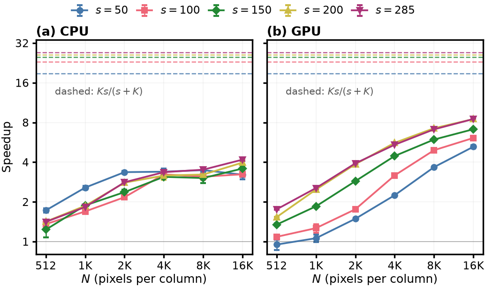

# Synthetic columns

Two experiments on synthetic CCD columns, one for the numerical agreement of
the two filters (Table II of the paper) and one for runtime as a function of N
and s (Fig. 1). Each column is drawn from a Gaussian with covariance
A Aᵀ + 10⁻³ I, A with standard normal entries, and shifted to positive values.
The CH4 template is the uniform vector 1/√s. Both use K = 30 and α = 10⁻⁴.
Hardware and software are listed in [environment.txt](../environment.txt).

## Agreement

One column per seed, s = 50, 100 seeds for each N. For every column we take
the P99, the mean (MAE) and the max of |FastMAG1C - MAG1C| over its N pixels.
The table gives the mean and standard deviation of P99 and MAE over the seeds,
and the largest max over all seeds. Values in ppm·m.

| Device | dtype | N | P99 | MAE | max |
|---|---|---|---|---|---|
| CPU | float64 | 512 | 1.44e-09 ± 2.02e-09 | 1.22e-10 ± 2.45e-10 | 7.87e-07 |
| CPU | float64 | 1024 | 6.85e-10 ± 8.86e-10 | 3.71e-11 ± 4.39e-11 | 9.70e-08 |
| CPU | float64 | 2048 | 3.86e-10 ± 6.11e-10 | 2.27e-11 ± 3.28e-11 | 2.13e-07 |
| CPU | float32 | 512 | 6.55e-01 ± 8.49e-01 | 4.24e-02 ± 6.03e-02 | 7.33e+01 |
| CPU | float32 | 1024 | 2.71e-01 ± 3.15e-01 | 1.67e-02 ± 1.84e-02 | 6.56e+01 |
| CPU | float32 | 2048 | 1.67e-01 ± 1.85e-01 | 9.56e-03 ± 1.01e-02 | 7.19e+01 |
| CUDA | float64 | 512 | 1.05e-09 ± 1.43e-09 | 7.85e-11 ± 1.28e-10 | 2.88e-07 |
| CUDA | float64 | 1024 | 4.43e-10 ± 5.12e-10 | 2.74e-11 ± 3.67e-11 | 1.88e-07 |
| CUDA | float64 | 2048 | 3.53e-10 ± 5.44e-10 | 1.97e-11 ± 2.56e-11 | 1.43e-07 |
| CUDA | float32 | 512 | 3.89e-01 ± 5.00e-01 | 2.70e-02 ± 4.42e-02 | 1.64e+02 |
| CUDA | float32 | 1024 | 1.61e-01 ± 1.86e-01 | 1.15e-02 ± 1.86e-02 | 1.48e+02 |
| CUDA | float32 | 2048 | 1.80e-01 ± 1.88e-01 | 1.04e-02 ± 9.91e-03 | 6.29e+01 |

In float64 the two filters agree to about 10⁻⁹ ppm·m. The difference comes
from summing in a different order, and grows through 30 Cholesky solves.

In float32 the typical error is small (MAE between 0.01 and 0.04 ppm·m), but
it changes a lot from one seed to the next. The standard deviation over seeds
is as large as the mean, and about a third of the seeds give a P99 of exactly
zero because most pixels of a plume-free column end at zero in both filters.
With this spread the averages for different N are not always ordered. On CPU
they decrease with N, while on CUDA the values for N = 1024 and N = 2048 are
within one standard deviation of each other. The max column is set by single
pixels that end at zero in one filter and above zero in the other, which is
the same effect seen on EMIT scenes in [emit_plumes](../emit_plumes/REPORT.md).

We checked on CPU that this code gives bitwise identical results to the
implementation used for the submitted version of the paper, in float64 and
float32.

## Scaling

Batches of 10 columns, N from 512 to 16384 and s in {50, 100, 150, 200, 285}.
Each configuration runs once to warm up and then 5 times. The speedup is the
ratio of the mean times, and its error bar is the standard deviation
propagated from both means. The dashed lines mark Ks/(s + K), the speedup of
the covariance step alone, which the full filter cannot reach because the
Cholesky factorization and solve are the same in both methods.



Speedup in float64.

| N | CPU, s = 50 | CPU, s = 285 | GPU, s = 50 | GPU, s = 150 | GPU, s = 285 |
|---|---|---|---|---|---|
| 512 | 1.72 | 1.41 | 0.95 | 1.35 | 1.76 |
| 2048 | 3.36 | 2.82 | 1.49 | 2.87 | 3.92 |
| 16384 | 3.22 | 4.18 | 5.24 | 7.11 | 8.50 |

On CPU the speedup levels off between 3.0 and 4.2 from N = 4096 on. On GPU it keeps
growing with N and with s and reaches 7.1 to 8.5 at N = 16384 for s ≥ 150.
With s = 50 and N = 512 the GPU shows no gain, because both filters are then
limited by kernel launches rather than arithmetic. Every configuration,
including float32, is in [table_scaling.md](table_scaling.md).

## Reproduce

```bash
python correctness.py        # correctness.csv
python scaling.py cpu        # scaling_cpu.csv
python scaling.py cuda       # scaling_cuda.csv
python summarize.py          # tables and scaling_speedup.pdf
```
